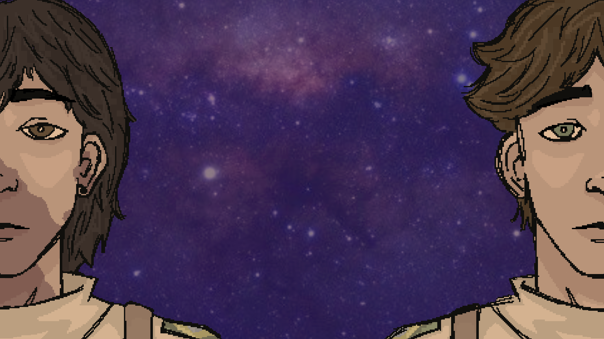
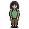
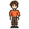
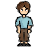
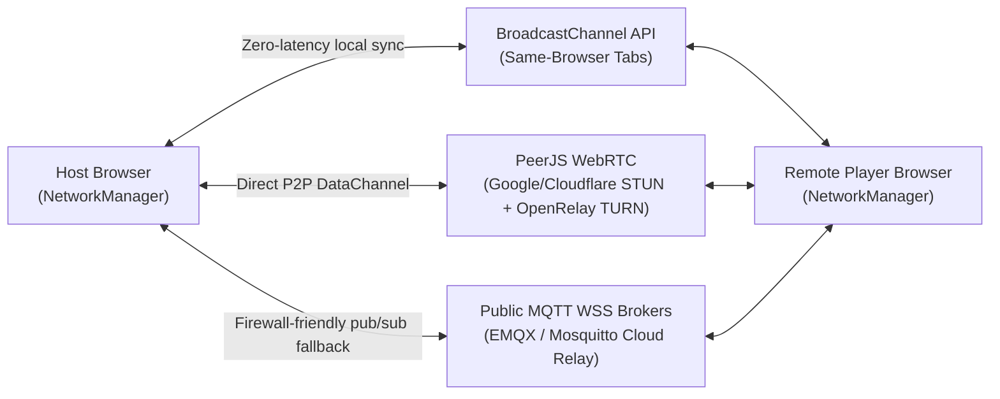

<div align="center">



# KIMU: Valley of Stars | KSC Mission Lab

**An interactive 2D pixel-art CubeSat engineering simulator and cross-network cooperative mission lab set at NASA's Kennedy Space Center.**

[](./js/renderer.js)
[](./js/main.js)
[](./css/styles.css)
[](./js/network.js)
[](./js/main.js)
[](./js/i18n.js)

[Overview](#overview) • [Key Features](#key-features) • [Meet the Specialists](#meet-the-specialists) • [NASA Missions](#nasa-inspired-missions) • [4-Stage Workflow](#4-stage-laboratory-workflow) • [Multiplayer Architecture](#multiplayer-architecture) • [Getting Started](#getting-started)

</div>

---

## Overview

**KIMU: KSC Mission Lab** challenges solo players or teams of up to 4 specialists to design, assemble, qualify, and launch real-world NASA CubeSat missions from start to orbit.

Walk through four interconnected Kennedy Space Center facilities in retro pixel art, balance realistic aerospace trade-offs (mass budgets, orbital power balances, reentry survivability, radio downlink bandwidth, launch licenses, and pad weather), survive environmental testing on the **DS-9000 Shaker** and **TVAC chamber**, and watch your custom configuration blast off from **Launch Complex 39A** in a multi-phase orbital deployment cutscene.

Built entirely with **zero-build static web technologies**, the simulator runs directly in any modern desktop or mobile browser and synchronizes across tabs, local Wi-Fi, or completely separate cellular/internet networks.

---

## Key Features

- **Cross-Network Cooperative Multiplayer (1 to 4 Players):** Share a room code (`KSC-XXX`) to collaborate in real time across different devices and networks. Each specialist slot is exclusively claimed by a single player at a time, movement interpolates smoothly across rooms, mission edits sync live, and only claimed specialists spawn inside the lab.
- **Real Aerospace Engineering Trade-Offs:**
  - **Mass & Volume (`1U` to `6U`):** Respect strict CubeSat dispenser limits (`1.33 kg` up to `8.00 kg`) or face disqualification during Mass & Dimensions inspection.
  - **Solar Power Budget (`W`):** Multiply raw solar generation by ADCS pointing efficiency (`65%` passive magnetic vs. `100%` 3-axis CMG) minus payload and radio draw. Negative power triggers live engineering warnings and fails the 24-hour orbital simulation (`DITL`).
  - **Space Safety & Compliance:** Choose `Aerospace Aluminum 6061-T6` for complete atmospheric burn-up (`ODAR` compliance), thermal-protected `UL 1642` batteries, redundant `Double Burn Wire` locks for deployable solar arrays/sails, and mandatory `NOAA` & `FCC/IARU` authorizations.
  - **Financial Reserve (`>= 10%`):** Manage mission grants, optional `$40,000` public outreach campaigns, launch vehicle fees, and testing rework penalties.
- **Interactive KSC Complex Map & 4-Room Pipeline:** Navigate rooms via laboratory doors, top-bar buttons, or the pixel-art Kennedy Space Center tactical map (`M`).
- **Animated Countdown, Cutscene & 1,000-Point Debrief:** Features a `T-00:10` ignition countdown, a 3-phase launch/fairing-separation/orbital cutscene with live altitude & velocity telemetry, NASA Two-Line Element (`TLE`) tracking generation, and a historical comparison report.
- **Procedural Web Audio Synthesizer:** Custom zero-asset audio engine (`KscSoundEngine`) producing constant-level ambient pad harmonies and melodies, UI chimes, footsteps, launch rumble noise filters, and a `0%–100%` volume slider.
- **6-Language Localization:** Instant UI, dialogue, mission data, canvas label, and map translation after clicking **Save** in Options:
  - Portuguese (`pt-BR`) | English (`en-US`) | Spanish (`es-ES`) | French (`fr-FR`) | Italian (`it-IT`) | German (`de-DE`)

---

## Meet the Specialists

Each player selects one of four Kennedy Space Center specialists in the **Server & Team** lobby:

| Portrait | Specialist | Role & Segment | Starting Facility | Core Focus |
| :---: | :--- | :--- | :--- | :--- |
|  | **Dr. Elena Vance** | Chief Scientist (`Science Segment`) | Room 1: Science Center | Mission selection, scientific payloads, CSLI grants, NOAA licensing |
|  | **Dr. Marcus Chen** | Spacecraft Engineer (`Spacecraft Segment`) | Room 2: Cleanroom | Chassis sizing, structure, solar/battery/ADCS integration & 4 lab tests |
|  | **Cmdr. Sarah Jenkins** | Testing & Ground Director (`Ground Segment`) | Room 3: Control (LCC) | FCC radio licensing, ground antennas (`VHF`/`UHF`/`S-Band`), weather & TLEs |
|  | **Eng. Roberto Silva** | Launch Director (`Launch Segment`) | Room 4: Pad 39A / VAB | P-POD/SSOD loading, RBF pin removal, Crawler rollout, orbit & rocket |

---

## NASA-Inspired Missions

Select one of five CubeSat missions modeled after real flights:

| Mission | Category | Base Budget | Required Sensor | Key Engineering Constraints |
| :--- | :--- | :---: | :--- | :--- |
| **BisonSat** | Earth & Environmental Science | `$120,000` | Visible Light Camera (`100m`, `50 MB/day`) | `LEO` / `Polar` orbit, requires `NOAA` camera license |
| **MinXSS** | Heliophysics & Space Weather | `$180,000` | Solar X-Ray Spectrometer (`80 MB/day`) | High-power `X-Ray` draw (`-4W`), `LEO` / `Polar` orbit |
| **BioNutrients** | Space Biology for Astronauts | `$150,000` | Microbial Incubator (`<250g`, `25 MB/day`) | `ISS (400 km)` orbit aboard `ISS Cargo Capsule` (`Dragon / Cygnus`) |
| **HaloSat** | Astrophysics & Cosmic Mysteries | `$250,000` | Galactic Halo Detector (`140 MB/day`) | Heavy payload (`-5W`, high downlink), requires `3-Axis CMG` pointing |
| **LightSail** | Next-Gen Solar Sail Propulsion | `$220,000` | `32 m²` Mirror Solar Sail + Camera (`60 MB/day`) | `NOAA` license + mandatory `Double Burn Wire` deployment lock |

---

## 4-Stage Laboratory Workflow

```
[ Room 1: Science & Mission ] ──> [ Room 2: Cleanroom & Tests ] ──> [ Room 3: Comms & Weather ] ──> [ Room 4: Pad 39A Liftoff ]
```

### Room 1: Science & Mission Center (`SLSL / Headquarters`)
- **Bench 1 (Mission & Payload):** Choose the target science contract and pair it with its matching camera or spectrometer.
- **Bench 2 (Budget & Approvals):** Approve the NASA Science Review & CSLI Launch Grant, optionally host a Public Outreach Campaign (`+$40,000`), and secure Earth-observation `NOAA` clearance.

### Room 2: Satellite Cleanroom Assembly (`SSPF / MPPF / TVAC`)
- **Bench 1 (Spacecraft Bus & Subsystems):** Configure:
  - **Chassis:** `1U` (`$10k`, `1.33 kg`) up to `6U` (`$65k`, `8.00 kg`)
  - **Structure:** `Aerospace Aluminum 6061-T6` vs. `High-Melt Titanium Alloy`
  - **Power & Control:** Side-mounted or Foldable Solar Wings (`+4W` / `+10W`), Battery (`UL 1642` vs. Commercial), `ADCS` pointing, and Single vs. Double Burn Wire retention.
- **Bench 2 (Qualification Lab):** Pass all 4 mandatory environmental tests (modifying hardware invalidates prior passes):
  1. `CAC`: Precision scale mass & dimension compliance
  2. `Shaker DS-9000`: Launch vibration test (`$5,000` rework penalty if deployables use a Single Burn Wire)
  3. `TVAC`: Thermal Vacuum Chamber (`-40°C` to `+80°C`)
  4. `DITL`: 24-hour orbital power balance simulation

### Room 3: Antennas & Environmental Control (`CIF / LCC / LTA`)
- **1. Radio & Antenna:** Register international `FCC / IARU` radio frequency and select ground downlink hardware (`VHF 140 MHz` `25 MB/day`, `UHF 437 MHz` `85 MB/day`, or `S-Band 2.4 GHz` `200 MB/day`).
- **2. Cape Weather:** Monitor Cape Canaveral lightning radar and clear the storm window before rollout.
- **3. 8-Item Readiness Poll:** Verify all cross-room launch gates (`GO` / `PENDING`).
- **4. TLE Tracking:** Inspect the dynamically generated Two-Line Element (`TLE`) orbital parameters and test the beacon telemetry signal.

### Room 4: Rocket Integration & Pad 39A (`VAB / Crawler / LC-39A`)
- Complete final pad procedures: **Load into P-POD/SSOD Dispenser** -> **Remove RBF (Remove Before Flight) Pin** -> **Roll Out with Crawler-Transporter**.
- Choose the target orbit (`ISS 400 km`, `LEO 550 km`, `Polar SSO 680 km`, `Lunar / Deep Space 384,400 km`) and compatible launch vehicle (`ISS Cargo Capsule`, `Minotaur IV`, `Falcon 9 / Atlas V`, `Rocket Lab Electron`, or `NASA SLS Mega-Rocket`).
- Initiate the countdown and inspect your **1,000-point engineering score**:

| Scoring Category | Max Points | Evaluation Criteria |
| :--- | :---: | :--- |
| Science & Matching Sensor | `300 pts` | Mission-payload match, target orbit compatibility & required CMG |
| Data Downlink Capacity | `200 pts` | Ground antenna throughput ratio vs. payload daily `MB` generated |
| Engineering, Safety & Tests | `220 pts` | Safe mass (`35`), positive power (`35`), `Al` ODAR (`25`), `UL` battery (`25`), Burn Wire (`20`) & 4 tests (`80`) |
| Licenses, Weather & Ops | `140 pts` | Science review (`35`), `NOAA` (`30`), `FCC` (`35`), clear skies (`20`), pad prep (`20`) |
| Budget & 10% Reserve | `140 pts` | Within total budget (`60`), `>= 10%` reserve kept (`55`), outreach campaign (`25`) |
| **Total Mission Score** | **`1,000 pts`** | Summarized with real NASA mission history comparison |

---

## Controls

| Platform | Action | Input |
| :--- | :--- | :--- |
| **Desktop** | Walk around lab | `W` `A` `S` `D` or Arrow Keys |
| **Desktop** | Move & auto-open bench | Left-Click anywhere on room floor or bench |
| **Desktop** | Interact with nearby bench / door | `E` or `Space` |
| **Desktop** | Toggle KSC Campus Map | `M` (or click room door / HUD button) |
| **Desktop** | Close open modal | `Esc` or `BACK` button |
| **Mobile / Touch** | Movement & interactions | On-screen D-Pad + `KSC MAP` & `OPEN STATION` buttons |

---

## Multiplayer Architecture

To support play across same-device browser tabs, local LAN, and separate Wi-Fi or 4G/5G networks without requiring a dedicated game backend, [`NetworkManager`](./js/network.js) combines three transport layers with message ID deduplication (`seenMsgIds`) and `1.6s` keep-alive heartbeats:



- **Exclusive Slot Arbitration:** Roles (`char1`–`char4`) are coordinated via `HELLO_JOIN`, `FULL_SNAPSHOT`, `CLAIM_ROLE`, `HEARTBEAT`, and `PLAYER_LEFT` packets, releasing slots automatically if a teammate disconnects or times out (`> 8.5s`).
- **Position Interpolation:** Remote teammates broadcast quantized coordinates every `~25ms` while moving and blend smoothly on receiving clients for fluid animations at `60 FPS`.

---

## Project Structure

```text
KIMU-KSC_Mission_Lab/
├── index.html                  # App shell, HUD, modals, overlays, and CDN script imports
├── css/
│   └── styles.css              # Pixel-art UI styling, equal-height card grids, sliders, scrollbars
├── js/
│   ├── i18n.js                 # 6-language translation dictionaries & flag SVG definitions
│   ├── gameData.js             # Missions, hardware catalog, rooms, guidance, simulation & scoring engine
│   ├── network.js              # Tri-layer multiplayer sync (BroadcastChannel + PeerJS + MQTT WSS)
│   ├── renderer.js             # 1280x720 Canvas renderer, KSC map generator, launch cutscene & sprite loader
│   └── main.js                 # Game loop, input/touch handling, modal controllers & Web Audio synthesizer
└── assets/
    ├── README.md               # Asset override specification
    ├── bg_menu.png             # Title screen backdrop artwork
    └── char[1-4]_*.png         # 28 pixel-art specialist sprites (front, left1-3, right1-3)
```

> **Note on Graphics:** `AssetLoaderManager` in [`js/renderer.js`](./js/renderer.js) automatically loads external `.png` files from [`assets/`](./assets/README.md) when present and falls back cleanly to crisp procedurally drawn pixel-art sprites for any missing benches (`prop_*.png`) or maps (`map_ksc.png`).

---

## Getting Started

### Option 1: Clone & Serve Locally (Recommended)

Because the app uses modern browser APIs (Clipboard, Web Audio, Canvas pixels, WebRTC, and WebSockets), serving the folder over HTTP works best:

```bash
git clone https://github.com/whyguiih/KIMU-KSC_Mission_Lab.git
cd KIMU-KSC_Mission_Lab
```

Run any static HTTP server from the repository root:

<details>
<summary>Choose your preferred local server command</summary>

- **Python 3:**
  ```bash
  python -m http.server 8080
  ```
  Then open `http://localhost:8080` in your browser.

- **Node.js:**
  ```bash
  npx serve .
  ```

- **XAMPP / Apache:**
  Place the cloned folder inside `htdocs/` and visit `http://localhost/KIMU-KSC_Mission_Lab/`.

- **VS Code:**
  Install the **Live Server** extension, right-click `index.html`, and select **Open with Live Server**.

</details>

### Option 2: Play Multiplayer With Friends

1. Open **SERVER** from the main menu.
2. **Host:** Click **GENERATE CODE** to create a room code (e.g., `KSC-401`), click **COPY**, pick your specialist, and click **PLAY**.
3. **Teammates:** Open the game on any device (same Wi-Fi or mobile 4G/5G), go to **SERVER**, enter the host's room code under **JOIN WITH CODE**, click **CONNECT**, pick an available specialist, and click **PLAY**.

### External Runtime Services Used

No `npm install` or build pipeline is needed. `index.html` and `js/network.js` load public runtime resources when online:
- Google Fonts (`Press Start 2P` and `VT323`) & Tailwind CSS CDN
- `PeerJS 1.5.4` & `MQTT.js 5.3.4` (`unpkg.com`)
- Public STUN/TURN (`stun.l.google.com`, `stun.cloudflare.com`, `openrelay.metered.ca`) & public MQTT WSS brokers (`broker.emqx.io`, `test.mosquitto.org`) for cross-network co-op

---

<div align="center">

Built with curiosity for orbital engineering and space science at **Kennedy Space Center**.

</div>
